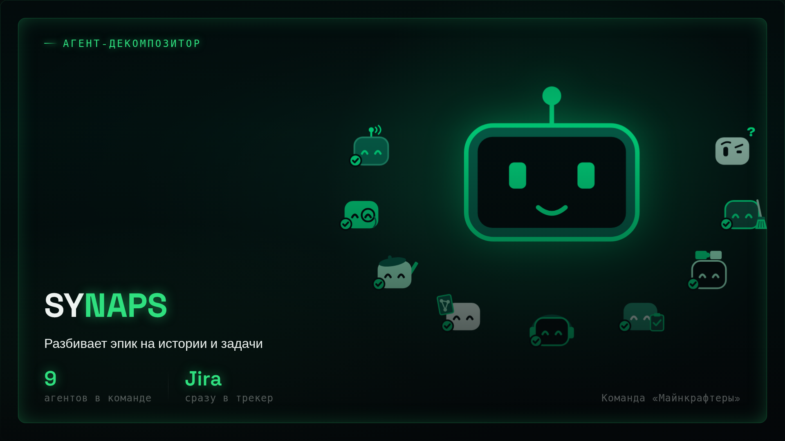
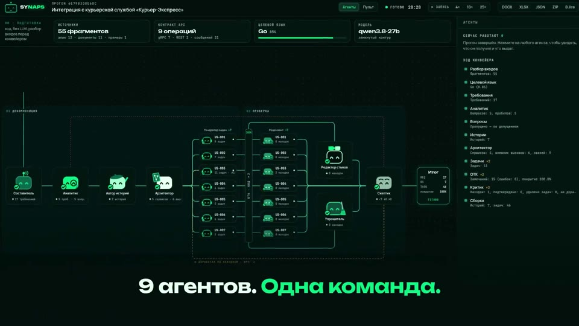
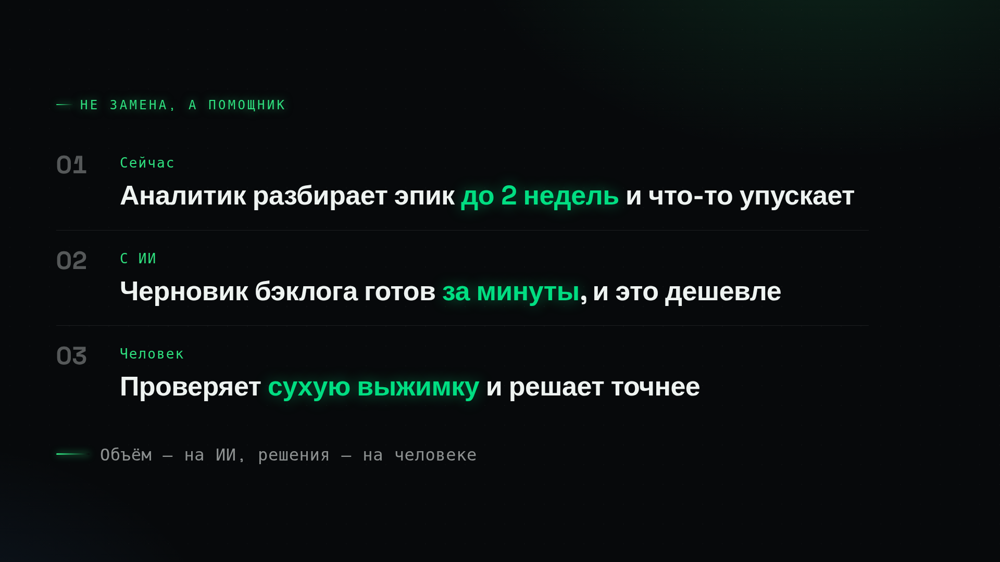
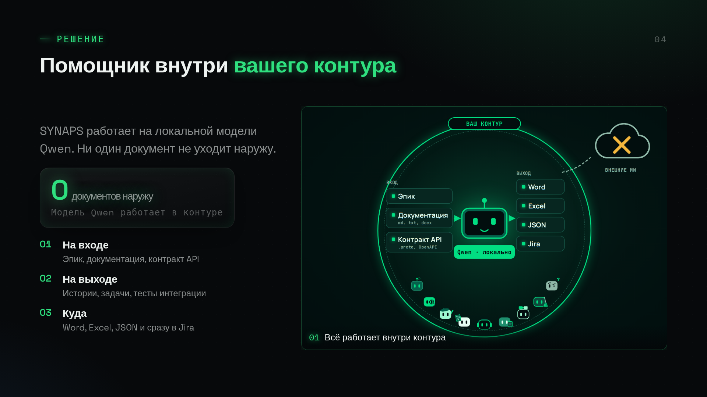
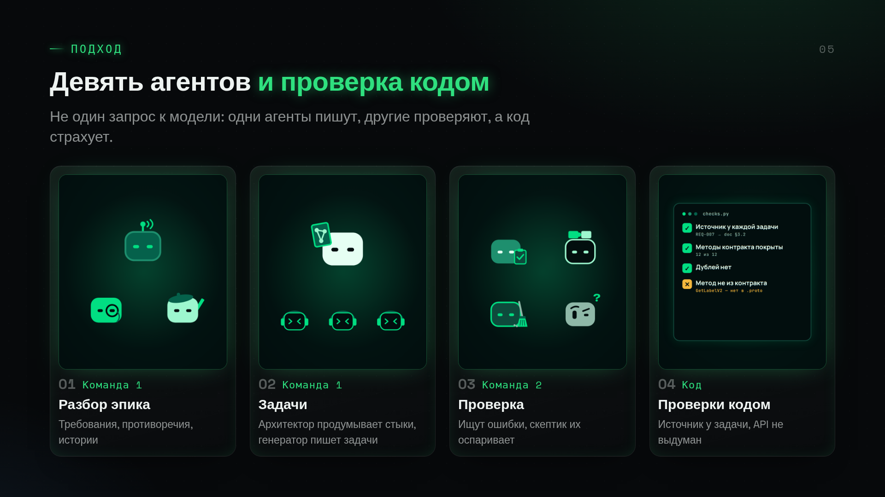
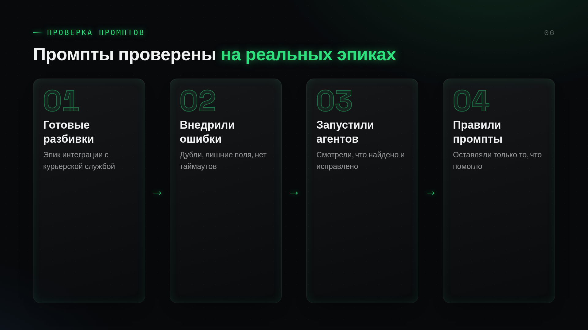
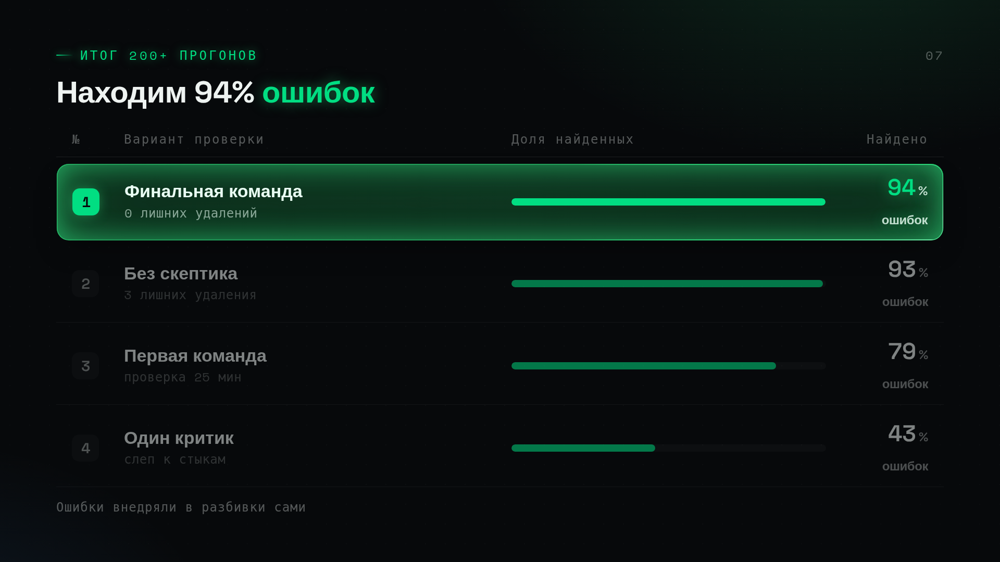
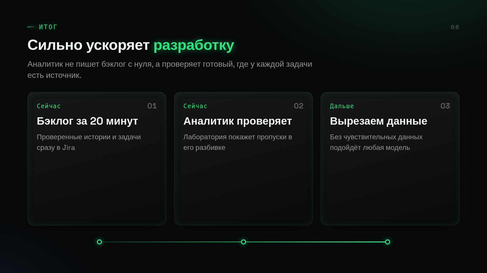

# SYNAPS

### Большая идея. Понятные задачи.

Из эпика, документации и API-контрактов — в проверенный бэклог.

[Презентация в PDF](media/SYNAPS_PRESENTATION.pdf) · [Трейлер](#трейлер)

## Трейлер

[Смотреть трейлер](media/synaps-demo.mp4?raw=true) · 1:06 · MP4, 1080p · 9,82 МБ

---

## Помощь нужна. Данные должны остаться внутри.

## Рутину — агентам. Решения — человеку.

## Ваши документы. Ваша модель. Ваш контур.

## Одни создают. Другие проверяют. Код страхует.

## Не верим промптам на слово — проверяем экспериментом.

## Меньше пропусков. Больше уверенности в задачах.

*94% — результат на наборе специально внедрённых дефектов, не гарантия для любого проекта. [Методика и ограничения](docs/review-benchmark.md).*

## Сегодня — проверенный бэклог. Дальше — больше свободы выбора модели.

## За командой агентов — команда людей.

---

**SYNAPS — от идеи к задачам, которые можно объяснить.**

[Презентация](media/SYNAPS_PRESENTATION.pdf) · [Бэкенд](backend/README.md) · [Фронтенд](frontend/README.md)

